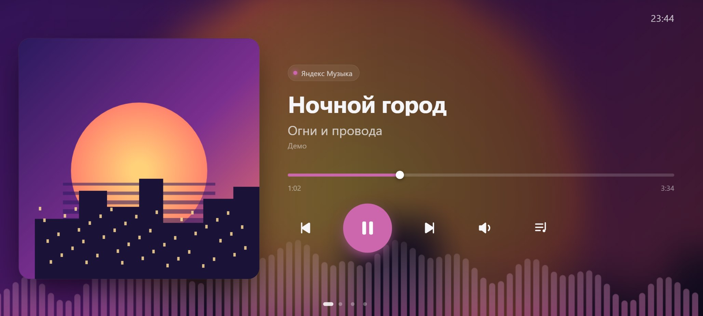
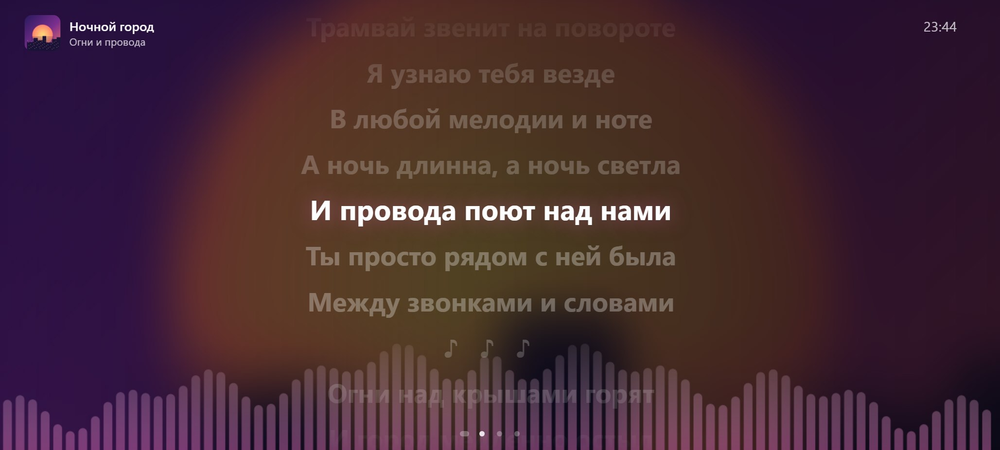
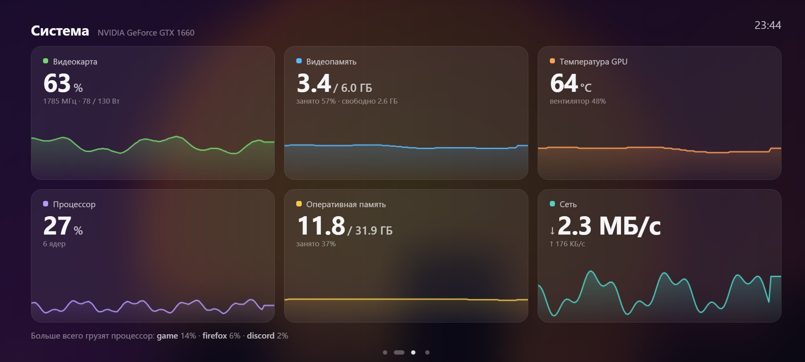
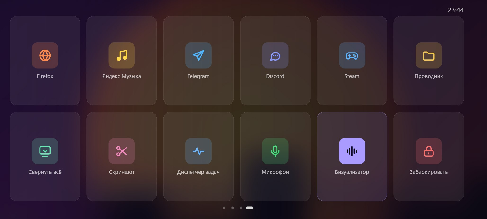

# MiniPlayer — старый телефон как второй сенсорный экран

Превращает старый Android-телефон в маленький сенсорный дисплей рядом с клавиатурой:
плеер с текстами песен, монитор видеокарты и пульт с кнопками. Страницы листаются свайпом.



| Текст песни в такт музыке | Монитор системы | Пульт |
|---|---|---|
|  |  |  |

## Возможности

- **Плеер.** Обложка, название, перемотка, громкость Windows с выезжающим ползунком. Фон и цвет кнопок подстраиваются под обложку.
  Работает с Яндекс Музыкой, Spotify, музыкой в браузере (ВК, YouTube) и почти любым проигрывателем: данные берутся
  из системного медиа-центра Windows, того же, что во всплывашке громкости.
- **Визуализатор.** Полоски внизу экрана прыгают под звук, который реально играет (захват WASAPI loopback).
- **Текст песни.** Синхронизированные тексты из бесплатной базы [LRCLIB](https://lrclib.net): текущая строчка светится, тап по строчке перематывает на неё.
- **Монитор системы.** Загрузка видеокарты NVIDIA, видеопамять, температура, мощность, процессор, оперативка, сеть, графики за 2 минуты и самые прожорливые процессы.
- **Пульт.** Плитки для запуска программ, «свернуть всё» (только на основном мониторе), скриншота, выключения микрофона и блокировки ПК. Настраивается в `deck.json`.
- **Клавиатура.** `Ctrl+Alt+←/→` переключает трек, а `Ctrl+Alt+↑/↓` меняет громкость, и то и другое из любой программы.
- **Бережёт AMOLED-экран.** Картинка незаметно сдвигается, кнопки притухают, без музыки экран затемняется.
- **Лёгкий.** Работает без видеокарты, всё вместе занимает около 3–4% процессора.

## Как это устроено

```
телефон (spacedesk Viewer) ──USB── Windows: второй монитор
                                      └─ окно Edge во весь экран ── http://127.0.0.1:8765 ── server.py
                                                                                              ├─ медиа-центр Windows (что играет)
                                                                                              ├─ громкость и микрофон (Core Audio)
                                                                                              ├─ NVML + psutil (монитор)
                                                                                              ├─ LRCLIB (тексты)
                                                                                              └─ deck.json (пульт)
```

Телефон становится вторым монитором через бесплатный [spacedesk](https://www.spacedesk.net/), а сам плеер
работает как небольшая веб-страница, которую локальный Python-сервер открывает во весь экран на этом мониторе.

## Установка

Нужно: Windows 10 или 11, телефон или планшет на Android, USB-кабель.

1. **Телефон как второй монитор.**
   - На компьютер поставь **spacedesk DRIVER** с [spacedesk.net](https://www.spacedesk.net/), на телефон — **spacedesk Viewer** из Google Play.
   - В spacedesk Console (значок возле часов) открой *Communication Interfaces → USB Cable Driver Android* и включи галочку **USB Cable Android**.
   - Подключи телефон кабелем (режим «Передача файлов») и выбери компьютер в spacedesk Viewer.
   - В Windows: *Параметры → Система → Дисплей → Расширить эти экраны*.
2. **Мини-плеер.**
   - Скачай архив (*Code → Download ZIP* или со страницы [Releases](../../releases)) и распакуй его в обычную папку, например `C:\MiniPlayer`.
   - Запусти `install.bat`. Он найдёт Python 3.10+ или предложит его поставить, установит библиотеки и создаст ярлык «Мини-плеер» на рабочем столе.
   - Запусти ярлык, и плеер откроется во весь экран на телефоне.

Подробная инструкция на русском лежит в файле [`ПРОЧТИ МЕНЯ.txt`](ПРОЧТИ%20МЕНЯ.txt).

## Управление

| Действие | Как |
|---|---|
| Переключить страницу | свайп влево/вправо, точки внизу или клавиши `1`–`4` |
| Предыдущий / следующий трек | `←` / `→` в окне плеера, `Ctrl+Alt+←/→` где угодно |
| Громкость | `↑` / `↓` в окне плеера, `Ctrl+Alt+↑/↓` где угодно, ползунок или колёсико |
| Пауза | пробел или большая кнопка |
| Перемотка | тап по полоске прогресса или по строчке текста |
| Полный экран | двойной тап по пустому месту |

## Настройка пульта

После первого запуска появится `deck.json`, в который пульт сам добавит найденные программы.
Файл можно править Блокнотом:

```json
{"id": "notes", "label": "Заметки", "icon": "app", "tint": "#a99bff",
 "action": {"type": "run", "path": "C:\\Windows\\notepad.exe"}}
```

Типы действий: `run` (программа, есть `args`), `url` (сайт), `keys` (сочетание вроде `"win+shift+s"`),
`minimize`, `mic`, `mute`, `lock`. Если добавить `"confirm": true`, плитка сработает только со второго нажатия.
Иконки: `globe`, `music`, `send`, `chat`, `gamepad`, `gem`, `code`, `folder`, `minimize`, `scissors`,
`activity`, `mic`, `waves`, `lock`, `app`.

## Демо-режим

Чтобы посмотреть интерфейс без музыки и телефона, открой `http://127.0.0.1:8765/?demo` при запущенном сервере.
В демо показываются выдуманная песня и фейковые цифры, и ни одна кнопка ничего не выполняет.

## Приватность и безопасность

- Сервер слушает только `127.0.0.1`, поэтому из сети к нему не подключиться.
- Команды принимаются только от своей страницы: чужие сайты в браузере не могут нажимать кнопки пульта.
- Пульт выполняет только то, что записано в `deck.json`.
- В интернет уходят только название и исполнитель песни, и только в LRCLIB для поиска текста. Никакой статистики и телеметрии.

## Ограничения

- Только Windows 10/11.
- Данные видеокарты показываются только для NVIDIA. С другими видеокартами эти плитки будут пустыми, остальное работает.
- spacedesk бесплатен для личного использования. Его лицензию для коммерческого использования смотри на сайте spacedesk.
- Тексты песен берутся из LRCLIB, права на сами тексты принадлежат их авторам.

## Структура

```
server.py          HTTP-сервер, сторож-перезапуск, окно на втором мониторе
mp/media.py        что играет (Windows SMTC через pywinrt)
mp/audio.py        громкость и микрофон (pycaw)
mp/sysmon.py       видеокарта и система (nvidia-ml-py, psutil)
mp/lyrics.py       тексты из LRCLIB с кэшем
mp/viz.py          спектр звука (SoundCard + numpy)
mp/deck.py         пульт
mp/hotkeys.py      глобальные клавиши
web/               интерфейс: app.js (ядро, свайп, защита экрана) + по файлу на страницу
```

## Поддержать

Если плеер пригодился, поставь ⭐. Это лучшая мотивация делать его дальше.

## Лицензия

[MIT](LICENSE). Используемые библиотеки распространяются под свободными лицензиями (MIT/BSD):
pywinrt, pycaw, comtypes, psutil, nvidia-ml-py, numpy, SoundCard.

---

### English

**MiniPlayer** turns an old Android phone into a small touch display next to your keyboard (via spacedesk):
a now-playing screen for any Windows media app with album-tinted visuals, an audio visualizer, time-synced lyrics (LRCLIB),
an NVIDIA GPU / system monitor and a Stream-Deck-style button panel. Windows 10/11 only. Install: unzip and run
`install.bat`, then launch the "Мини-плеер" desktop shortcut. Runs locally on `127.0.0.1`, no telemetry.
